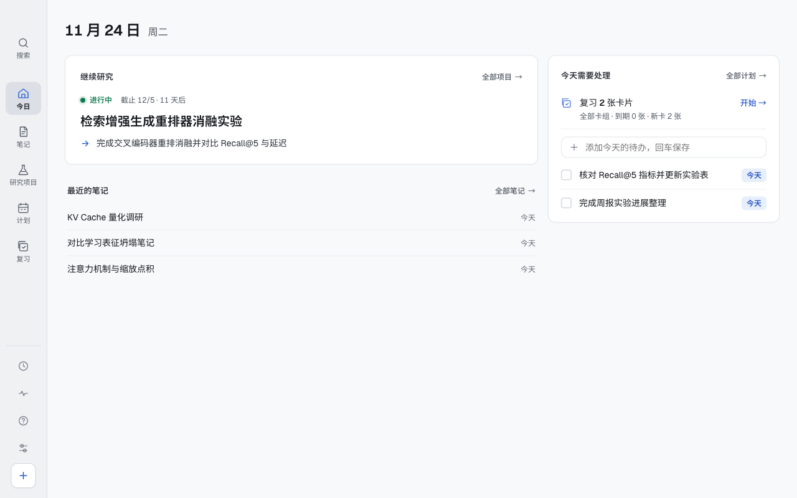
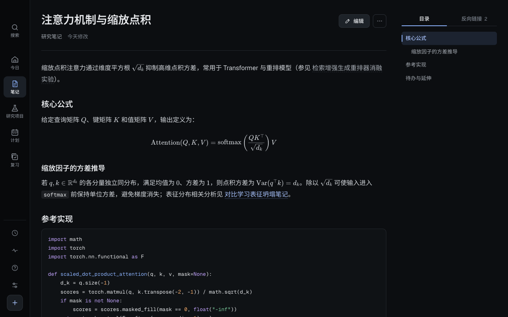
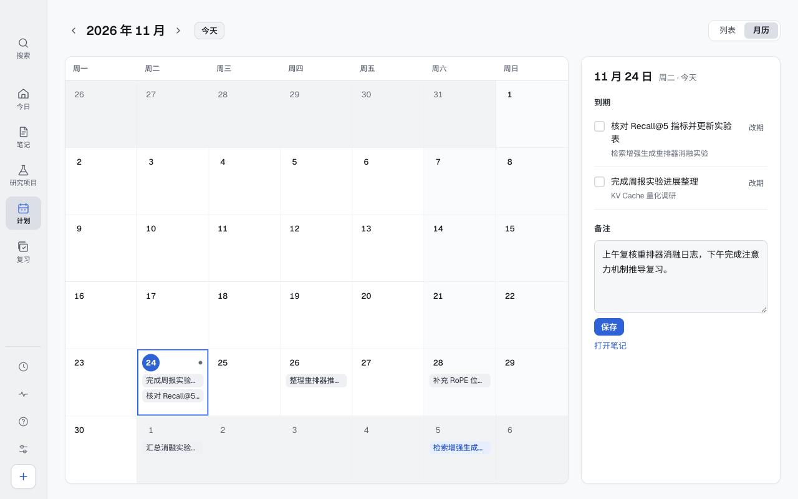
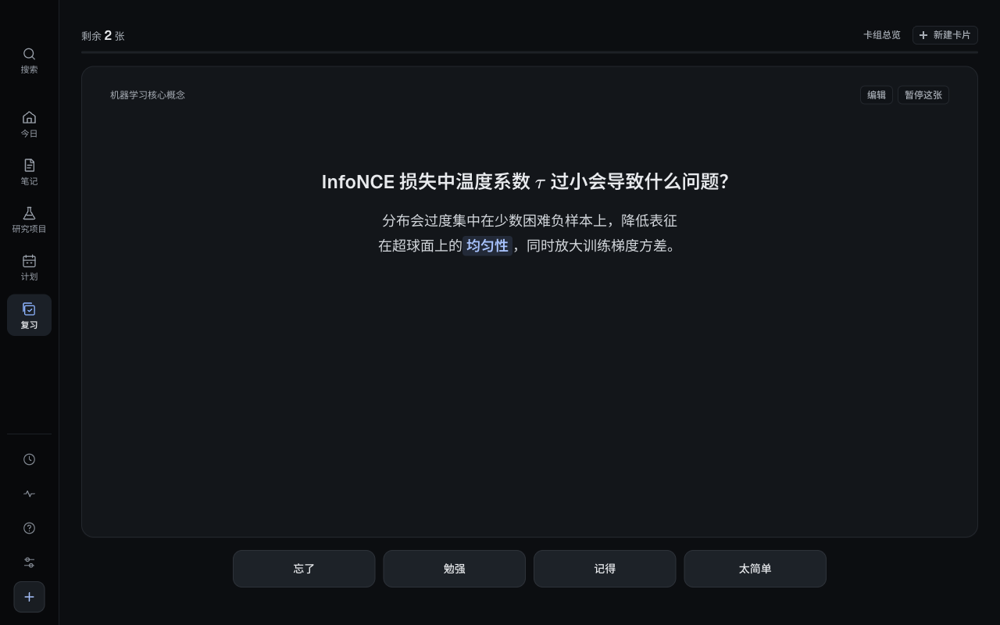

# Workstation Mini

English · [简体中文](README.zh-CN.md)

**Workstation Mini** is a local-first desktop application for research notes, task planning, and spaced repetition. Record experiment logs, link related notes, turn findings into flashcards, and schedule follow-up work in one place. Notes and card decks are stored as plain Markdown files that remain readable in any external editor; review events are recorded as JSON Lines, and the SQLite search index is derived from and rebuildable from the vault.

> The desktop interface is in Simplified Chinese. The Chinese UI labels referenced below match the buttons and pages in the application.



---

## Installation and Quick Start

Download the platform installer from [GitHub Releases](https://github.com/zhidacaishu/workstation-mini/releases/latest) along with `SHA256SUMS.txt` if you wish to verify checksums:

- **Windows (x64)**: `*-setup.exe` (unsigned).
- **macOS (Apple Silicon)**: `*-mac-arm64.dmg` (ad-hoc signed; not notarized by Apple).

Workstation Mini does not include automatic updates; install newer versions manually from GitHub Releases.

> **Branch note:** This README documents the current `main` branch. To check what is included in a packaged release, consult its release notes. Unreleased changes on `main` are listed under **未发布** in [CHANGELOG.md](CHANGELOG.md).

### First-Run Workflow

1. **Open or create a vault:** On first launch, create a new vault (**创建新资料库**), open an existing directory (**打开现有资料库**), or restore from a backup (**从备份恢复**). Recovery accepts a Git repository or a local backup and validates it before switching.
2. **Create a note:** Open **新建** and enter a title. New notes default to `notes/inbox/`, with an automatically generated unique filename that can be edited before saving.
3. **Track tasks:** Add a Markdown task to any note, then open **计划** to view it in the task list or monthly calendar. Checking off a task or changing its due date updates the original Markdown line directly.
4. **Create and review flashcards:** Open **复习** to create your first flashcard, or select text on a note's reading page to convert the selection into a card.

Click the question mark in the sidebar to open the built-in guide (**上手指南**), which provides an interactive interface tour, a first-use checklist, and a Git setup check tailored to your vault.

---

## Core Capabilities

| Workflow | How It Works |
| --- | --- |
| **Search & Linking** | Toggle search and the command palette with `Ctrl+K` (Windows/Linux) or `⌘K` (macOS), including quick commands for workspace pages. Type `[[` in the editor to autocomplete links to other notes. The reading view displays the document outline and backlinks. |
| **Experiment Tracking** | Create a research project note and record the dataset, parameters, seed, commit, result, and next step. The project board and Today page surface the next action, with one-click undo when moving cards across columns. |
| **Deadlines & Daily Notes** | Write Markdown tasks such as `- [ ] Run the ablation @2026-12-01`. Undated tasks appear under **计划 → 未安排**. Checking off or rescheduling a task updates the original Markdown line directly, refreshes the overdue badge live, and supports inline revert and exact one-click undo. Daily calendar notes are stored in `notes/calendar/YYYY-MM-DD.md`. |
| **Images & Equations** | Paste or drop PNG, JPEG, GIF, or WebP images (up to 15 MB each). The editor saves them to `attachments/` and inserts an embed link. Inline and display math render offline using bundled KaTeX. |
| **Spaced Repetition** | Use a level-two heading (`##`) for the card front and the body text below for the back. Wrap phrases in `{{double braces}}` to create cloze deletions. FSRS schedules subsequent reviews based on your rating, and creating cards from note selections autocompletes existing decks. |

### Flashcard Example and Review Controls

Save the following Markdown in `cards/experiments.md` to define a card:

```markdown
## Why record the random seed?

It lets another run reproduce the same sequence of random choices.
```

During review, press **Space** to reveal the answer, **1–4** to rate recall, or **Z** to undo the last rating. Cards rated **忘了** are re-queued at the end of the current session. Editing a card's front, moving it to another deck, or suspending it preserves its review identity; suspending a card—either in-place from the card list or mid-review—can be undone immediately. Save shortcuts (`Ctrl+S` on Windows/Linux, `⌘S` on macOS) work consistently across note and card editors, calendar notes, selection-to-card dialogs, and Settings.

### Workspace Preview

| Note Reading (Dark · KaTeX & Outline) | Monthly Calendar (Light · Tasks & Daily Notes) |
| --- | --- |
|  |  |

**Spaced Repetition Review (Dark · Cloze Highlight & FSRS Ratings)**



---

## Vault Layout and Local History

| Content | Location |
| --- | --- |
| Notes and research projects | `notes/` in the vault |
| Card decks and review events | `cards/*.md` and `reviews/YYYY-MM-DEVICE.jsonl` |
| Images, audio, and linked media | `attachments/` and `audio/` |
| Note version history and editor drafts | `notes/.workstation-local/` |
| Deck history and Git conflict/abort snapshots | `.workstation-local/` at the vault root |
| SQLite search index | One index per vault under `workstation-data/index/` in the app data directory |

### Local History and Draft Protection

- **Atomic version preservation:** Before overwriting an edited note, the application saves its previous contents to local history. If writing the history record fails, the original file remains untouched on disk and your edits remain in the editor so you can check disk space or write permissions and retry.
- **Version inspection and drafts:** Open **历史与草稿** to compare versions line by line, restore a note or card deck, or recover an unsaved draft. Because local history captures individual saves, it preserves intermediate revisions between Git commits.
- **Retention policy:** For each note, the latest 20 ordinary saves are kept in full, while older saves within the past 60 days are compacted to one version per local day. Deletion and conflict snapshots follow separate retention rules. Both local history and drafts remain strictly on the local device.
- **Unsaved work and confirmation safety:** Destructive delete confirmations default focus to **Cancel**. Background reindex completion and task undo operations never discard unsaved editor, calendar note, or quick-add inputs; if edits are in progress, the app preserves them and offers a manual refresh action instead.
- **Windows session-end handling:** When Windows initiates a shutdown, restart, or sign-out, any unsaved edits in notes, cards, or settings trigger a prompt allowing you to save, discard, or return to editing.

---

## Optional Git Sync

To use Git sync, point the vault directory to the **vault's own Git working-tree root** (linked worktrees are also supported). In **上手指南 → Git**, the application inspects your Git installation, repository status, commit identity, and remote configuration, and lists any remaining setup commands.

Automatic sync is disabled on a fresh installation and can be enabled in **设置 → Git 同步**. Assign a distinct device name on each machine so each writes to its own review log file.

- **Sync cycle:** Full sync commits tracked or addable changes, fetches remote updates, rebases when required, and pushes. Review your vault's `.gitignore` before enabling sync. When a local repository has no remote configured, the application still creates local commits. If background fetches require authentication, configure credentials in your terminal.
- **Push rules:** Full sync honors explicit Git push configurations. For example, under `push.default=simple`, if a local `main` branch tracks `origin/published` on the same remote, sync halts before pushing and reports both branch names. Review-only sync verifies the target branch and outgoing commits prior to pushing review logs; if the remote branch advances after that check, the push is aborted.
- **Conflicting edits:** In **设置 → Git 同步**, inspect the two sides of each conflicting file and choose the local version, the remote version, or a manually merged file. Before replacing a note or deck, the application saves the complete working copy—including edits within the common-ancestor section of a three-way conflict—and the discarded version in local history. Other files (such as attachments) are backed up byte-for-byte to `.workstation-local/git-conflicts/`. Any backup failure aborts the overwrite, and if a manually merged file still contains conflict markers, the UI reports the offending line number.
- **Recovery and diagnostics:** You can continue or abort a merge/rebase from Settings, or resolve it directly with Git in the vault directory. Before aborting, pending changes to notes, decks, and review logs are backed up under `.workstation-local/git-abort/`. Open **资料库健康** to inspect the search index, review logs, and Git status.

---

## Development and Verification

Requires **Node.js 22.12.0 or later**. Run the following commands from the repository root:

```sh
npm ci
npm run dev
```

| Command | Purpose |
| --- | --- |
| `npm test` | Run the core regression suite (storage, indexing, Git sync, and vault recovery) |
| `npm run test:desktop` | Run Electron desktop interaction tests against temporary vaults |
| `npm run desktop:build` | Build the Windows x64 NSIS installer |
| `npm run desktop:build:mac` | Build the Apple Silicon macOS disk image (`.dmg`) |
| `npm run verify-mac-package` | Verify architecture, native binaries, bundled resources, and signatures for the packaged macOS app |

### CI and Release Pipeline

Pushes to `main` and pull requests automatically run the Linux core regression suite. For platform-specific verification, manually trigger the **CI** workflow and select Windows or macOS. Pushing a `v*` tag matching `package.json` triggers the release workflow, which publishes installers and checksums after Linux regressions as well as Windows and macOS packaging and packaged desktop tests pass.

For editor shortcuts, detailed retention policies, or the scope of the Mini edition, see the [Chinese User Guide](README.zh-CN.md) and [Feature Scope](docs/MINI-SCOPE.md).
