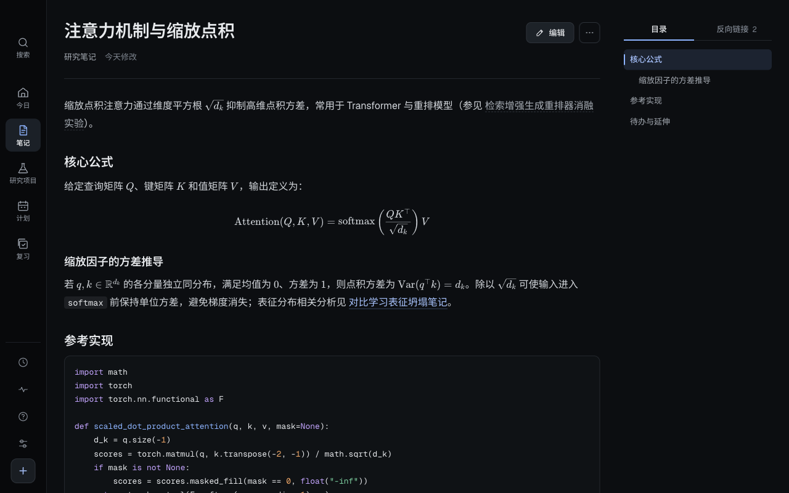
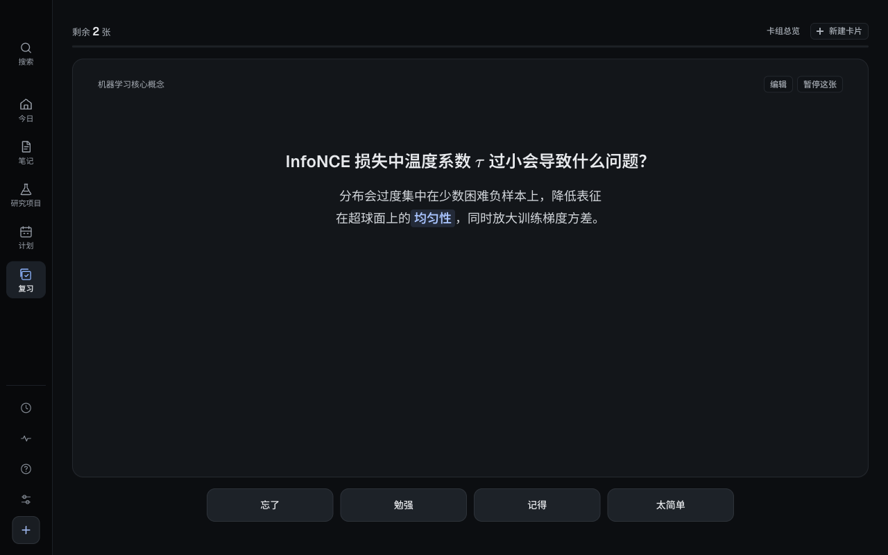

# Workstation Mini

[English](README.md) · 简体中文

**Workstation Mini** 是面向 AI 研究者（用于科研积累与实习准备）的精简版本地知识工作台，围绕**记录知识、快速检索、规划下一步、间隔复习**四项核心任务设计。应用以本地 Markdown 作为唯一数据真源，SQLite 仅作可随时重建的派生索引，FSRS 复习事件以 JSONL 格式存储；所有笔记与卡组均可脱离应用、使用任意纯文本或 Markdown 编辑器打开。


---

## 安装与首次使用

从 [GitHub Releases](https://github.com/zhidacaishu/workstation-mini/releases/latest) 下载对应平台的安装包，并可配合同页的 `SHA256SUMS.txt` 校验文件完整性：

- **Windows x64**：`*-setup.exe`（未配置代码签名）。
- **Apple Silicon Mac**：`*-mac-arm64.dmg`（使用 ad-hoc 签名，未经 Apple 公证）。

Mini 版不提供自动更新，升级时从发布页手动下载新版安装即可。桌面界面采用简体中文。

> **版本说明：** 本文档对应当前 `main` 分支。具体安装版所含功能以对应标签的发布说明为准；当前分支上尚未发布的改动见[更新日志](CHANGELOG.md)的 **未发布** 一节。

### 首次启动流程

1. 首次启动时，可选择**创建新资料库**、**打开已有资料库**，或从 **Git 仓库 / 本地备份**恢复资料库。
2. 进入工作区后，可在「今日」页面的上手清单引导下写下第一篇笔记。
3. 在笔记中记录待办事项，并在「计划」页面统一管理。
4. 前往「复习」页面创建并完成第一张卡片复习。

---

## 核心能力

- **知识笔记与检索**：支持 Markdown 知识笔记、全文搜索、双链与反链；新建笔记时先填写标题，默认保存至 `inbox/`。
- **卡片与间隔复习**：支持普通卡、挖空卡、划词建卡及 FSRS 间隔重复算法；支持应用内编辑、删除、暂停与跨卡组移动卡片，评为「忘了」的卡片会在本轮末尾重学。
- **轻量研究项目**：支持记录研究项目与实验信息（数据集、参数、seed、commit、结果、结论与下一步）。
- **统一计划工作区**：集成了待办列表、到期筛选、月历视图与当天备注；支持在阅读页直接勾选待办，以及本机历史版本与草稿恢复。
- **本地优先与 Git 同步**：提供可重建索引、原子写入、可选 Git 文本同步与冲突保护机制。
- **资料库健康诊断**：只读查看索引状态、复习日志与 Git 状态，辅助排查异常。

### 界面预览






---

## 新手指引

### 界面导览

首次打开工作台时，会显示约一分钟的界面导览：包含 1 个欢迎页和 6 站高亮说明。导览在遮罩层上高亮侧栏真实入口（搜索、笔记、研究项目与计划、复习、历史与健康，以及底部的指南、设置与新建），并配合卡片说明用途。支持「上一步」「下一步」与方向键翻页，按 `Esc` 或点击「以后再说」即可跳过；跳过或看完后不再自动弹出。导览仅介绍界面入口位置，不会修改笔记或设置，也不会在编辑、新建或复习页面自动打断操作。

### 上手清单

在新资料库中，「今日」页会显示「开始使用」清单，包含四步：**写下第一篇笔记**、**把一件事写进计划**、**做第一张复习卡片**、**完成第一次复习**。各步骤的完成状态直接根据资料库中是否存在对应笔记、待办、卡片与复习记录实时判定，不额外保存进度——因此打开长期使用过的资料库时会自动全部勾选并隐藏。清单仅提示下一步与对应入口，支持手动隐藏，只读模式下不显示。

### 上手指南与 Git 环境探测

点击侧栏左下角的问号图标可打开「上手指南」（`/guide`，亦可通过命令面板搜索打开），内容涵盖完整上手清单、笔记与公式、搜索与快捷键、待办与计划、卡片与复习、Git 版本记录、出错与恢复速查，以及「重新看界面导览」入口。导览进度与清单隐藏状态保存在本机应用配置目录，跨页面及应用重启均保留，不写入资料库；已完成或跳过旧版八步指引的用户升级后不会再被打断。

指南中的 Git 一节会只读探测当前资料库状态——包括是否安装 Git、是否已是 Git 仓库、是否配置提交身份、是否配置远端以及自动同步是否开启——仅列出仍缺失的终端命令（按实际资料库路径生成，支持一键复制），并引导前往设置的「同步」开启自动同步。未配置远端时仍可生成本地提交；配置好远端和凭据后才会执行推送。指南不会主动执行 Git 命令，也不会代为开启同步；本地版本历史与 Git 提交彼此独立。

---

## 笔记、卡片与待办

### 笔记与编辑器

- **新建与命名**：新建笔记时先填写标题，默认路径为 `inbox/标题.md` 且随标题自动更新；重名时依次顺延为「标题 2」「标题 3」。手动修改「保存到」路径后不再自动跟随。标题与正文首行的 `# 标题`（研究项目则为 frontmatter 的 `title:` 字段）保持双向同步。从「研究项目」或看板分栏新建时，目录切换为对应栏目；从尚未创建的 `[[双链]]` 新建时，直接使用链接中的路径。路径未写扩展名时自动补全 `.md`。
- **列表与翻页**：「笔记」列表每页显示 50 篇并支持翻页；按分区筛选时，「共 N 篇」仅统计当前分区。月历备注不会出现在今日页的「最近的笔记」中。
- **媒体链接**：笔记中指向 `attachments/` 或 `audio/` 下图片、音频、视频的链接（包括 `![[录音.mp3]]`），点击后调用系统默认应用打开。
- **编辑交互**：
  - 按回车自动续写列表、待办和引用块，空项再按回车结束续写；`Tab` / `Shift+Tab` 控制缩进（先按 `Esc` 再按 `Tab` 可将焦点移出编辑框）。
  - 输入 `[[` 弹出笔记补全列表。
  - 粘贴或拖入图片（支持 PNG、JPEG、GIF、WebP，单张不超过 15 MB）会自动保存至 `attachments/`（以当前时间命名），并在光标处插入 `![[文件名]]`。
  - 窗口宽度不小于 1180 px 时，可通过工具栏「预览」按钮开启右侧实时预览，开关状态保存在本机。
  - 代码块按 `` ```语言 `` 标注的语言进行高亮，未标注语言则不作猜测。

### 计划与待办

- **快速添加**：计划页列表视图与今日页顶部的输入框均支持直接添加待办，内容写入今天的月历备注 `calendar/日期.md`。
- **阅读页勾选与展示**：笔记阅读页中的 `- [ ] 待办 @日期` 渲染为可交互勾选框，勾选后直接写回原 Markdown 行；日期标签会标明跨年年份、「今天」和「逾期」。
- **今日页聚合**：今日页「今天需要处理」仅展示今天到期和已逾期的待办（最多 5 条，其余通过「还有 N 条」跳转至计划页）；无到期事项时展示接下来的 3 条。未设置日期的待办仅在计划页的「未安排」筛选中显示。

### 卡片与间隔复习

- **卡组与编辑**：卡片保存在 `cards/*.md` 中，`##` 标题为正面，下方正文为背面。在「复习」页点击卡组名或「全部卡片」，可逐张查看、修改正反面、移至其他卡组、删除或暂停复习；复习过程中也可直接编辑或暂停当前卡片。
- **身份固定与版本校验**：修改正面或移动卡组时，应用会在卡片下方写入一行 `<!-- workstation:card:v1 {...} -->` 以固定其身份，避免复习记录丢失；暂停状态同样记录在该行中，不另建存储。编辑仅修改当前卡片所在行，并在写入前校验卡组文件版本，若文件被外部修改则提示刷新。
- **重学与撤销**：复习时评为「忘了」的卡片会排入本轮末尾再次出现，结束时统计本轮重学数量，评分照常记入复习日志。评分后可通过「撤销上一张」按钮或 `Z` 键撤销最后一次评分并重新作答。撤销动作同样追加至复习日志，原评分保留但不再计入排期；多台设备同步合并后依然有效（各设备均需使用支持撤销事件的版本）。挖空卡翻面后会在题面原位显示并高亮答案。

---

## 数据存储与本地历史

| 内容 | 存储位置 | 是否随 Git 同步 |
| --- | --- | --- |
| 笔记、卡组、复习日志 | 资料库内的 `notes/`、`cards/`、`reviews/` | 是 |
| 图片与媒体文件 | 资料库内的 `attachments/`、`audio/` | 是（遵循资料库的 `.gitignore` 规则） |
| 笔记历史与草稿 | `notes/.workstation-local/` | 否 |
| 卡组历史、Git 冲突与中止操作现场副本 | 资料库根目录的 `.workstation-local/` | 否 |
| 搜索索引（SQLite） | 应用数据目录 `workstation-data/index/`（每个资料库独立一份） | 否 |
| 应用设置、指引进度 | 应用数据目录 | 否 |

- **笔记版本历史**：按笔记分目录存放——最近 20 个普通保存版本全部保留；更早版本在 60 天内按本机日期每天保留最后一份，超出 60 天的版本会在下次保存该笔记时清理。删除笔记前留下的副本、中止 Git 操作前的快照以及解决冲突时未采用的版本均不参与自动清理。若历史副本写入磁盘失败，编辑器会保留新稿并提示重试，磁盘原文件保持不变；清理旧版本失败（如文件被占用）不影响当前保存，将在下次保存时继续清理。旧版平铺的历史记录会在首次查看或保存时自动迁移。
- **卡组版本历史**：修改或删除卡组前的版本保存在本机历史中，在「历史与草稿」内标记为「卡组」，支持整份恢复至原位置。删除单张卡片前的卡组版本标记为「删卡前」：60 天内全部保留，超过 60 天每天仅保留最早一份（因此同一天内先新增或编辑、随后又删除的卡片，超过 60 天后可能无法找回）。
- **差异对比与冲突备份**：在「历史与草稿」中选中版本后，默认以逐行差异对比展示其与当前文件的变化（增删着色，未变更的大段折叠），支持切换为全文视图；文件超过 2 MB 或改动超过 2000 行时直接显示全文。解决同步冲突时未采用的一侧也会保存在此，标记为「冲突未采用」。
- **草稿清理**：放弃编辑后留下的草稿若超过 30 天未更新，将在应用启动时自动清理。
- **索引存放与迁移**：旧版索引曾存放于资料库根目录的 `workstation.db`，在云盘同步场景下易发生损坏；新版改为按资料库存放在应用数据目录中。资料库中遗留的旧 `workstation.db`（及 `-wal`、`-shm`）若超过 3 天未被修改，打开资料库时会自动删除；若 3 天内仍有更新，则说明存在旧版客户端在使用，应用会予以保留。超过 90 天未打开的资料库索引会自动清理，后续打开时按需重建。
- **设备命名**：设备名用于区分复习日志文件（`reviews/YYYY-MM-设备名.jsonl`），不可留空。新安装时由主机名加随机后缀生成并写入设置，此后修改主机名不会改变设备名；从旧版本升级的设备沿用原主机名规则，继续写入同一日志文件。可在「设置」中修改设备名，多台设备请勿重名。
- **Frontmatter 与换行兼容**：笔记属性区（frontmatter）仅识别 YAML；`---js`、`---json` 等其他格式不会被执行，阅读页会展示原文并提供「修复」入口。笔记与卡组文件均兼容 CRLF 换行。

---

## Git 同步

### 仓库要求与同步流程

- **仓库根目录要求**：资料库目录必须直接作为 Git 工作树的根目录（支持普通仓库及 linked worktree）。若资料库仅为上级仓库中的普通子目录，应用将跳过同步，以免提交或推送资料库以外的文件；此时可在资料库目录内单独执行 `git init` 建立独立仓库。未启用 Git 时，本地笔记、历史与复习功能照常可用。
- **自动同步与超时控制**：同步默认关闭，可在「设置 → 同步」开启。存在远端时，每轮同步依次执行：提交本机修改 → `fetch` → `rebase`（不使用 autostash）→ 推送。无远端时仅作本地提交。启动时的后台拉取不阻塞窗口打开；退出应用时最多等待同步 20 秒。
- **非交互凭据**：同步过程不会弹出登录框（`GIT_TERMINAL_PROMPT=0`，Git Credential Manager 设为非交互模式；未自定义 ssh 命令时，SSH 采用 `BatchMode`，不交互询问口令或主机指纹）。若远端需要认证，同步会报错并提示在终端中运行一次 `git fetch` 完成登录，之后由凭据管理器或 `ssh-agent` 记住凭据。本地 Git 命令超时为 60 秒；`fetch` 与 `push` 因涉及附件传输，总时限放宽至 30 分钟，但若网络速率持续过低会提前中止，避免同步长时间挂起。变基期间应用会暂停写入笔记和复习评分，待变基完成后继续，防止双端互相覆盖。

### 推送规则与复习同步

- **显式推送规则**：若用户显式配置了 Git 推送规则，完整同步会严格遵循。例如在 `push.default=simple` 下，若本地 `main` 分支跟踪同一远端的异名上游分支，Git 会在推送阶段停止并提示。复习同步仅向已核验的目标分支推送，若目标与推送配置不符则会提示检查设置。
- **复习后独立同步**：每次复习结束会单独触发一次复习记录同步，同样不使用 autostash：若此时远端已有新提交且本机存在未提交的笔记修改，本次仅在本机提交复习记录，待下一轮完整同步再统一拉取与推送。

### 冲突解决与操作中止

- **保留现场与逐文件选边**：当两台设备修改同一文件并引发 Git 冲突时，同步会立即停止并保留冲突现场，不自动覆盖任一端，也不继续推送。在「设置 → Git 同步」中会逐个列出冲突文件，每个文件可选择「用远端的」或「用本机的」（若一端已删除文件，则显示「跟它一样删掉」），也可展开查看双方的逐行差异；若已在外部编辑器中手工清理完冲突标记，还可选择「用现在文件里的内容」。全部选定后点击「按选择解决并继续同步」，应用将完成变基并在后台执行一轮同步（若本机累积了多个未推送提交，可能需要再次选边）。
- **冲突备份保护**：选边覆盖前，笔记与卡组当前的完整内容（包括三方冲突中的共同祖先段与手工批注）均会预先存入「历史与草稿」；附件等其他文件的原始字节副本保存在资料库 `.workstation-local/git-conflicts/` 下。手工合并后若仍检测到明确的冲突标记，设置窗口会指出所在行号。若任意备份写入失败，应用将终止覆盖并保留原文件。笔记或卡组未被采用的一侧会存入「历史与草稿」并标记为「冲突未采用」，可随时找回；复习记录双端均会保留，无需选边。
- **中止与手工处理**：也可点击「中止当前 Git 操作」恢复至同步前状态，或直接在资料库目录中使用 `git status`、`git add`、`git rebase --continue` 手工处理。对于 `cherry-pick`、`revert` 等非同步流程产生、无法区分远近端的状态，不支持在应用内选边。中止 Git 操作前，未提交（含已暂存）的笔记、卡组与复习日志快照会写入本机 `.workstation-local/git-abort/`，同时将笔记和卡组存入「历史与草稿」。任意备份写入失败都会阻止中止操作；若 Git 中止后补回复习日志失败，应用会明确报错，同时在本地保留完整快照。

### 换行规范与升级建议

- **统一换行符**：开启同步后，应用会在资料库根目录维护 `.gitattributes`（与 `.gitignore` 一样，仅补充缺失规则，不改动用户已有规则），使 `*.md`、`*.jsonl` 在 macOS 与 Windows 之间统一采用 LF 换行，防止 Git for Windows 的 `core.autocrlf` 将卡组转换为 CRLF。
- **多设备协同**：多台设备请尽量同步升级：旧版本在同步时仍可能将冲突标记写入笔记；同一卡组内存在正面相同的卡片时，新旧版本计算的卡片 ID 可能不一致，混用会导致这些卡片的复习记录无法对齐。

---

## 数学公式

笔记阅读页与复习卡片支持本地 KaTeX 渲染：行内公式写作 `$\log x$`，块级公式使用独占一行的 `$$` 包围；支持分数、矩阵、分段函数与 `aligned` 多行推导。所需 CSS 与字体随应用本地打包，离线环境可正常渲染。编辑页保留 Markdown 原文，语法错误的公式回退显示源码，超宽块级公式在各自区域内横向滚动。

- 代码块、行内代码与转义美元符号不参与公式渲染。
- 行内公式须写在同一行内，且定界符内侧不要留空格；普通文本中的美元符号（如金额）可写作 `\$` 以避免歧义。
- 当前版本不提供公式自动交叉引用或公式内部局部挖空。
- 普通文本挖空沿用 `{{答案}}` 语法；如需挖空整条公式，可写作 `{{ $\frac{a}{b}$ }}`。数学公式内部的成对大括号按 LaTeX 分组解析，不会被识别为挖空。
- 划词建卡会保留所选公式的 TeX 源码，即使仅选中公式的一部分也会完整保留整条公式；多行选区自动填入卡片背面，正面标题可在保存前修改。

---

## 精简边界

- **功能取舍**：Mini 版不包含错题本与外部写作检查器、Zotero 同步、PDF 解析与问资料库、独立日记、历年今日与多套回顾页、知识图谱、自动知识质量分析、自动相似建议、影子跟读、字幕与转写、博客 MDX 发布、独立投稿及教材进度看板。原始完整项目保持不变，本仓库为独立项目。
- **计划工作区定位**：计划工作区（`/plan`）支持列表与月历切换——列表视图可查看逾期、今天到期、未安排、截止事项与已完成任务；月历视图可直接完成或调整待办到期日、查看项目期限并编辑当天备注。日期语义为截止日而非执行时间。备注保存于 `notes/calendar/YYYY-MM-DD.md`，待办仍写回原 Markdown 行，不创建第二份日程数据；不包含重复日程或系统提醒。
- **外部工具边界**：Mini 版不替代完整日程管理软件、提醒工具、IDE、实验追踪平台或通用 AI 助手；项目笔记可通过链接关联外部运行记录、代码仓库与论文来源。应用内不提供内置 AI 调用、API Key 配置或笔记模板选择器。
- **兼容路由与恢复范围**：`/tasks`、`/calendar`、`/deadlines` 仅作为统一计划页的兼容入口，不再维护独立页面。资料库恢复保留 Git 克隆、本地备份复制、索引验证与安全切换，不提供远程大文件补齐，但会一并复制本地备份中已有的普通文件。
- **平台与模块精简**：界面仅面向 Electron 桌面窗口设计，不做移动端适配。研究项目不再解析旧版审稿意见、导出回复稿或计算习题完成度；复习功能保留实际队列与评分，不提供未来负荷预测。既有 Markdown 字段与复习事件格式保持向后兼容。

---

## 界面与桌面体验

### 视觉规范与窗口行为

- **「石墨」视觉体系**：主窗口、设置窗口与资料库恢复窗口统一采用「石墨」视觉语言——窄图标侧栏、石墨灰底色与冰蓝强调色；深色与浅色主题完整对应，可在设置中选择「跟随系统」「浅色」或「深色」；逾期状态统一采用琥珀色并附带明确文字说明。
- **本地打包字体与样式变量**：界面字体随应用打包分发（西文 Geist / Geist Mono，中文思源黑体 Noto Sans SC，均为 OFL 许可），确保 macOS 与 Windows 观感一致且不依赖在线字体。等宽字体仅用于代码、文件路径、commit 与 frontmatter 字段名，编辑区使用正文字体，日期与计数使用正文字体的等宽数字。颜色、字号（9 档）、圆角（6 档）、控件高度与动效统一定义在 `src/public/tokens.css`，由三个窗口共享，组件样式仅引用这些变量。
- **窗口框架与最小尺寸**：macOS 下隐藏系统标题栏，红绿灯控制钮直接嵌入侧栏顶部；Windows 与 Linux 保留系统标题栏，菜单栏默认收起，按 `Alt` 呼出。首次启动先进入欢迎页，在「创建新资料库 / 打开现有资料库 / 从备份恢复」三个入口中选择，仅在选择恢复时才进入分步恢复界面。主窗口最小宽度为 900 px，设置窗口最小宽度为 760 px。

### 交互细节与未保存保护

- **无顶栏布局**：界面不设顶部工具栏，侧栏「搜索」入口用于唤起命令面板（`⌘K` / `Ctrl+K`；在资料库页面按 `/` 可聚焦搜索框），侧栏角标仅提示逾期待办与到期卡片数。
- **阅读与排版**：
  - 今日页聚焦展示 1 个最优先推进的研究项目、最近的笔记与「今天需要处理」（首行为本轮待复习卡片，其下为今日到期及逾期待办；新资料库顶部额外显示可隐藏的上手清单）。
  - 笔记阅读页将 `- [ ] 待办 @日期` 渲染为可直接勾选的复选框与日期标签；未指定别名的 `[[双链]]` 自动显示目标笔记标题（不修改原文）。
  - 阅读页正文随窗口宽度自然展开，不设最大行宽并保留左右边距；右侧支持在「目录 / 反向链接」间切换，多级标题目录支持点击跳转、当前章节高亮与独立滚动，空笔记不预留侧栏空间。
  - 主页面充分利用可用宽度并对齐页头基线，列表按内容延伸；首页、看板、阅读侧栏与月历随窗口尺寸自适应分栏。编辑器与复习卡片利用剩余高度；历史页在选中记录后展开预览栏；研究看板以标题为主、数据集为辅，下一步与截止日分列排布；计划页月历高度随窗口调整，日期侧栏仅保留「到期」「备注」等必要信息。
- **无障碍与未保存保护**：保留可见的键盘焦点样式、保存快捷键与「减少动态效果」支持。编辑页、卡片编辑页或设置存在未保存修改时，离开页面、关闭窗口、退出应用或应用新设置前均会弹出跟随当前主题的确认框；离开编辑页前内容会自动存为本机草稿。Windows 关机、重启或注销时，若存在未保存的笔记、卡片编辑或设置，将提示用户保存、放弃或返回编辑；若保存失败，内容将留在窗口中以便重试。

### 图标与系统托盘

主窗口、设置窗口及首次使用 / 恢复窗口在开发模式与安装版中均使用项目图标（Windows 使用多尺寸 ICO，macOS 开发模式同步设置 Dock 图标）。系统托盘沿用系统原生菜单；Windows 托盘菜单左侧的图标 / 勾选预留区域属于系统原生布局，不由应用 CSS 干预。

---

## 开发与验证

### 环境与常用命令

需要 **Node.js 22.12.0 或更高版本**：

```bash
npm ci
npm run dev          # 启动 Electron 开发窗口（与 npm start 等价）
npm test             # 运行核心回归测试（含资料库恢复与激活验证）
npm run test:desktop # 使用临时资料库运行真实桌面交互测试
```

`better-sqlite3` 自带 N-API 预编译文件，安装依赖时无需 Python 或 Visual Studio 构建工具；请务必使用上述脚本运行测试，而不要直接通过系统 Node.js 执行依赖 SQLite 的测试文件。

### 测试覆盖与运行约定

- **测试职责划分**：纯逻辑与配置检查统一由 `npm test` 执行；`npm run test:desktop` 仅运行真实桌面窗口用例，按文件串行执行以避免原生窗口争抢焦点。
- **桌面交互与几何回归**：桌面测试使用临时资料库覆盖设置/恢复入口、草稿跨重启恢复、待办更新、已删除笔记恢复、卡片管理与复习中编辑/暂停、阅读页勾选待办、按标题新建笔记以及主题切换时的未保存编辑保护，不触碰真实资料库。布局回归在明暗主题下检查 900 / 1100 / 1440 px 窗口中的长卡组、历史长路径与操作按钮；主页面额外验证 900 / 1440 / 1920 / 2560 px 下的全宽边距、历史预览分栏及编辑与复习区的剩余高度；设置窗口自 760 px、恢复窗口自 900 px 起检查底栏对齐、末位控件可达性、长错误信息换行及恢复残留提示按钮高度。
- **验收产出约定**：布局断言常规执行，成功用例的验收截图仅在配置 `WORKSTATION_VISUAL_OUTPUT` 环境变量时输出；失败截图自动保留并在日志中打印路径。本地 UI 验收截图、测试日志与临时资料库应置于系统临时目录或仓库 `tmp/` 下，不提交至版本库。

### CI、打包与发布

- **CI 流程**：推送至 `main` 或提交 PR 时，CI 自动运行 Linux 核心回归测试；需要验证桌面平台时，可在 GitHub Actions 手动运行 CI 并勾选对应平台。
- **本地打包**：Windows 使用 `npm run desktop:build`（NSIS 安装器），macOS 使用 `npm run desktop:build:mac`（Apple Silicon，ad-hoc 签名）。应用主体按白名单仅打包 `electron/`、`src/`、应用元数据及运行依赖，运行时图标另行随包分发；本地 `tmp/`、`dist/`、测试脚本与旧安装包不打入应用主体，且仅携带当前平台的 SQLite 预编译文件。
- **发布与安全加固**：Mini 不支持自动更新，打包配置中 `publish` 为空，不会生成更新清单。推送与包版本一致的 `v*` 标签后，Release 工作流会执行回归测试、构建 Windows x64 与 macOS arm64 安装包并运行打包态验证，再发布至 GitHub Releases（Windows 安装包未配置代码签名，macOS 为 ad-hoc 签名且未经 Apple 公证）。打包后的应用通过 Electron fuses 禁用了 `ELECTRON_RUN_AS_NODE` 与 `NODE_OPTIONS`，仅从 `asar` 加载应用代码，因此不可作为通用 Node 运行时执行脚本；开发与测试使用 `node_modules` 中未加固的 Electron。

---

> **使用建议：** 首页建议仅保留三项信息——今天要复习什么、哪道题尚未掌握、当前项目下一步是什么。卡片用于主动回忆；开放题、项目追问与真实代码练习用于检验迁移能力，避免将“看到答案时觉得熟悉”误判为已经掌握。
